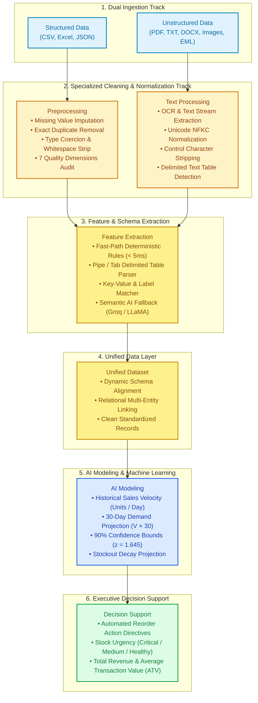
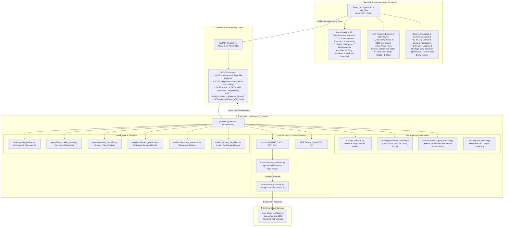

# DataFlow — AI-Powered Data Cleaning, Schema Normalization, Entity Matching & Business Analytics

DataFlow is an enterprise-grade, end-to-end data engineering platform and web application designed to automatically extract, clean, profile, normalize, and resolve entities across diverse structured and unstructured document formats. It executes **all 12 fundamental data cleaning operations**, audits datasets against the **7 industry data quality dimensions**, extracts delimited text tables and multi-record documents, and provides an **AI-driven Inventory Demand Forecasting & Business Analytics Engine**.

---

## 🎯 Problem & Solution Statement

### ❌ Problem Statement
> **Existing systems can extract text from unstructured files, but they often fail to automatically understand the data structure, identify separate records, determine appropriate fields, and convert the extracted information into a clean structured format. Fixed rules and predefined schemas are not flexible enough for documents with different layouts and wording.**

### ✅ Solution Statement
> **Develop a dynamic unstructured-data processing system that extracts content from files, cleans the extracted text, automatically identifies the entity and schema, separates individual records, maps values to standardized fields, normalizes and validates the data, and generates structured JSON, CSV, Excel, or database-ready output. This allows different types of unstructured data to be converted into a consistent table without manually defining the structure for every new document.**

---

## 🏗️ Dual-Ingestion Enterprise Architecture

DataFlow uses a **Dual-Ingestion Pipeline** where structured datasets (CSV, XLSX, JSON) and unstructured documents (PDF, TXT, Images, DOCX, EML) follow specialized preprocessing tracks before converging into a unified dataset for AI modeling and executive decision support:



---

## 🏛️ System & Component Architecture



---

## 📈 Business Analytics & Inventory Demand Forecasting

DataFlow transforms cleaned operational datasets into statistical forecasts and automated purchasing decisions.

### Inventory Demand Forecasting Table Columns

| Column | Metric Definition | Mathematical Calculation | Practical Meaning |
| :--- | :--- | :--- | :--- |
| **`Item Name`** | Product / SKU Identifier | Cleaned entity name or model identifier | Specifies the item being forecasted (e.g. `M3`, `Air Filter Pro`). |
| **`Current Stock`** | On-Hand Inventory | Aggregated warehouse units | Current physical stock available for immediate fulfillment. |
| **`Daily Velocity`** | Average Sales Speed | $\text{Velocity} = \frac{\sum \text{Units Sold}}{\text{Observation Window (Days)}}$ | Average volume of units sold or ordered per 24 hours. |
| **`Predicted Demand`** | 30-Day Forward Demand | $\text{Demand} = \text{Daily Velocity} \times 30$ | Total forecasted demand across the upcoming 30-day horizon. |
| **`Confidence Bounds`** | 90% Statistical Interval | $\text{Demand} \pm 1.645 \times \text{Standard Error}$ | Upper and lower range accounting for demand volatility. |
| **`Status / Urgency`** | Automated Stock Health | Comparison of Current Stock vs. Upper Bound | Categorized as 🟢 **Healthy**, 🟡 **Medium**, or 🔴 **Critical**. |
| **`Reorder Action`** | Actionable Directive | $\text{Reorder} = \text{Upper Bound} - \text{Stock} + \text{Safety Buffer}$ | Automated directive for procurement managers with exact reorder quantities. |

### Stock Urgency Decision Rules

```
                      ┌───────────────────────────────────────┐
                      │ Compare Current Stock vs. Upper Bound │
                      └──────────────────┬────────────────────┘
                                         │
                 ┌───────────────────────┴───────────────────────┐
                 │                                               │
      [Current Stock >= Upper Bound]               [Current Stock < Upper Bound]
                 │                                               │
                 ▼                                               ▼
       ┌───────────────────┐                         ┌───────────────────────┐
       │     HEALTHY       │                         │ Projected Stockout:   │
       │ Stock fully covers│                         │ Stock / Daily Velocity│
       │ 30-day forecast.  │                         └───────────┬───────────┘
       │ No action needed. │                                     │
       └───────────────────┘                     ┌───────────────┴───────────────┐
                                                 │                               │
                                          [Days <= 7 Days]                 [Days > 7 Days]
                                                 │                               │
                                                 ▼                               ▼
                                       ┌───────────────────┐           ┌───────────────────┐
                                       │ CRITICAL URGENCY  │           │  MEDIUM ATTENTION │
                                       │ Immediate reorder │           │ Schedule order in │
                                       │ with 7-day buffer │           │ regular cycle     │
                                       └───────────────────┘           └───────────────────┘
```

---

## ⚡ The 12 Fundamental Data Cleaning Operations

Every dataset processed through DataFlow undergoes all 12 fundamental data cleaning operations with element-level change provenance tracking:

| # | Fundamental | Implementation & Behavior |
|:---:|---|---|
| **1** | **Data Profiling** | Pre-cleaning and post-cleaning statistical distributions: total rows/cols, detected data types, null counts/percentages, unique value counts, min/max, quartiles ($Q_1, Q_2, Q_3$), and frequency distributions. |
| **2** | **Missing Value Handling** | Configurable missing value standardization across `null`, `None`, `NaN`, `N/A`, `Missing`, and whitespace strings. Preserves structural nulls, applies verified constants or safe statistical imputations, and flags records requiring review. |
| **3** | **Duplicate Removal** | Multi-level deduplication: exact duplicate row elimination, fuzzy duplicate identification via Levenshtein / Jaro-Winkler similarity, and foreign-key preservation for transaction records. |
| **4** | **Data Type Correction** | Automatic inference and strict casting of numeric values, floating points, booleans, dates, timestamps, emails, and postal codes with fallback preservation of original unparseable text. |
| **5** | **Format Standardization** | Standardizes dates to ISO 8601 (`YYYY-MM-DD`), names to Title Case, phone numbers to international E.164, and currency values to clean numeric floats. |
| **6** | **Text Cleaning** | Sanitizes text fields using Unicode NFKC normalization, strips non-printable control characters, trims extra whitespace, standardizes punctuation, and removes repeated consecutive phrases. |
| **7** | **Outlier Detection** | Non-destructive statistical outlier detection using Interquartile Range ($1.5 \times \text{IQR}$) and Z-score thresholds ($\|z\| > 3.0$). Outliers are audited and flagged without destructive data loss. |
| **8** | **Data Validation** | Validates records against strict domain schemas (Store, Item, Customer, Transaction, Medical, Academic, Automotive). Flags outer vs. inner ID conflicts, invalid email syntax, negative prices, and anomalous future dates. |
| **9** | **Inconsistency Correction** | Harmonizes casing variants (e.g. `USA`, `U.S.A.`, `United States`), standardizes status values (`active`, `pending`, `inactive`), and ensures conflicting field values are reconciled without data loss. |
| **10** | **Data Transformation** | Canonical schema mapping with row-by-row alias coalescing (`first_name` + `last_name` $\rightarrow$ `full_name`), location parsing (`"Miami, FL"` $\rightarrow$ `city: Miami`, `state: FL`), and clear isolation between `selling_price` and `cost_price`. |
| **11** | **Entity Matching** | Deterministic and probabilistic candidate matching across records using inverted token indexing, TF-IDF scoring, and Union-Find connected components to identify same-entity clusters. |
| **12** | **Quality Verification & Provenance** | Computes pre/post quality improvement metrics across completeness, validity, uniqueness, and consistency, while recording an element-level audit provenance log for every modification. |

---

## 🎯 The 7 Data Quality Dimensions

In addition to the 12 processing fundamentals, DataFlow audits datasets against the 7 industry standard data quality dimensions:

1. **Missing Values**: Evaluates cell-level completeness and null percentages across each column.
2. **Duplicates**: Detects exact duplicate records and approximate candidate duplicates.
3. **Wrong Data Types**: Flags mismatches between detected semantic types and raw values.
4. **Invalid Values**: Tests conformance to format rules (regex email, phone numbers, postal codes, positive quantities).
5. **Outliers**: Highlights statistical anomalies beyond IQR distribution boundaries.
6. **Format Differences**: Identifies inconsistent date representations (slash vs dash), casing irregularities, and currency symbols.
7. **Record Matching**: Evaluates potential duplicate entities that may represent the same real-world identity.

---

## 📄 Form Parser & Universal Document Split-Viewer

For unstructured files and documents, DataFlow features an interactive split-screen Document Analysis workspace:
* **Interactive Document Canvas**: Real page rendering for PDF and images, complete with zoom (50%–200%), 90° page rotation, and bounding box inspection.
* **Structured Spreadsheet View**: Renders an interactive spreadsheet preview for CSV and tabular datasets rather than an empty page.
* **Delimited Text Table Extractor**: Automatically detects pipe-delimited (`|`), tab-delimited (`\t`), or semicolon-delimited (`;`) records inside `.txt` files (e.g. `bmw_inventory_sample_220_items.txt`), promoting them into structured tables with full analytics.
* **4-Tab Data Drawer**:
  - **Key-Value Pairs**: Field names, extracted values, and confidence scores ($>98\%$).
  - **Extracted Tables**: Paginated multi-column tables with row numbering.
  - **Standardized Entities**: Named Entity Recognition (NER) tags and normalized tokens.
  - **Raw OCR Data**: Monospace raw text stream with one-click clipboard copying.

---

## ⚡ Performance & Scalability Benchmarks

DataFlow is optimized for high-throughput enterprise workloads:
* **Vectorized Data Profiling & Auditing**:
  - Scans **50,000+ rows / 3MB+ datasets** in **~4.4 seconds** (reduced from >25s).
  - Uses pandas C-level vectorized operations, regex fast-paths, and column-level domain filtering.
* **Zero-Freeze Frontend Pagination**:
  - Result tables, OCR table previews, and Quality Inspector diagnostic cards use client-side pagination (**15–25 rows per page**).
  - Eliminates main-thread JavaScript freezing when working with tens of thousands of records.

---

## 🚀 Getting Started

### Prerequisites
- **Python**: 3.10 to 3.14
- **Node.js**: v18+ and **npm**
- **Git**

### Installation

1. **Clone the repository:**
   ```powershell
   git clone https://github.com/Kiruthikeyan-S/data-clean.git
   cd data-clean
   ```

2. **Install Python backend dependencies:**
   ```powershell
   pip install -r requirements.txt
   ```

3. **Install and build frontend dependencies:**
   ```powershell
   cd frontend
   npm install
   npm run build
   cd ..
   ```

4. **Configure environment variables (Optional for Cloud LLM features):**
   Create a `.env` file in the root directory:
   ```env
   GROQ_API_KEY=your_groq_api_key_here
   PORT=8080
   HOST=127.0.0.1
   ```

---

## 🏃 Running the Application

### Option 1: Unified Server (Recommended)
Runs FastAPI and automatically serves the built React frontend at port **8080**:
```powershell
python run.py
```
- **Web Application:** [http://127.0.0.1:8080](http://127.0.0.1:8080)
- **Interactive Swagger Docs:** [http://127.0.0.1:8080/docs](http://127.0.0.1:8080/docs)
- **Custom Port:** `python run.py --port 9000` or `python run.py 9000`

### Option 2: Frontend Development Mode (Hot-Reload)
```powershell
# Terminal 1: Backend
python run.py

# Terminal 2: Frontend Dev Server
cd frontend
npm run dev
```
Open [http://localhost:5173](http://localhost:5173).

---

## 🧪 Automated Testing Suite

The repository includes a comprehensive automated test suite verifying all pipeline components:

```powershell
# 1. Test All 12 Fundamental Data Cleaning Operations
pytest test_12_fundamentals.py -v

# 2. Test BMW Spare Parts & Vehicle Sales Demand Adapters
pytest test_bmw_demand_adapter.py -v

# 3. Test Business Analytics & 50-Item Demand Prediction
pytest test_business_analytics_demand_50.py -v

# 4. Test Universal Unstructured Pipeline & Pipe-Delimited Tables
pytest test_universal_unstructured_pipeline.py -v

# 5. Test Hybrid JSON Extraction & Cross-File Linking
pytest test_hybrid_json_extraction.py -v

# 6. Test All 8 Ingestion Formats (CSV, Excel, JSON, TXT, DOCX, EML, PDF, Image OCR)
python test_all_formats.py
```

---

## 📡 REST API Reference

| Method | Endpoint | Description |
|:---:|---|---|
| `POST` | `/api/process` | Process a single uploaded file (CSV, Excel, JSON, PDF, TXT, DOCX, EML, Image). |
| `POST` | `/api/process-batch` | Process multiple files simultaneously with cross-file linking, deduplication & entity resolution. |
| `POST` | `/extract` or `/api/extract` | Universal extraction endpoint accepting multipart files or JSON/text payload. |
| `GET` | `/health` or `/api/health` | Health check endpoint returning system status and version. |
| `GET` | `/api/export/{task_id}/{format}` | Export processed dataset to `excel`, `csv`, `pdf`, or `json`. |
| `GET` | `/api/batch/{batch_id}/export/{format}` | Export multi-file batch to multi-sheet `excel` or structured `json`. |

---

## 📁 Repository Directory Structure

```
data-clean/
├── backend/
│   ├── analytics/             # Demand forecasting & business analytics engine
│   ├── cleaning/              # Structured cleaner, entity splitter, text cleaner, data auditor
│   ├── extractors/            # Vision OCR, PDF, TXT, DOCX, Email extractors
│   ├── extraction/            # Delimited table parser, field extractor, AI batch extractor
│   ├── matching/              # Cross-file linker, Union-Find identity resolver, record matcher
│   ├── normalization/         # Canonical schema mapper, value standardizer, normalizer
│   ├── models/                # Entity schemas & Pydantic response models
│   ├── quality/               # Data quality profiler (vectorized statistical profiles)
│   ├── routes/                # FastAPI endpoints (process, batch, export, health)
│   ├── utils/                 # MIME & magic file sniffer
│   ├── pipeline.py            # Master end-to-end processing pipeline
│   └── main.py                # FastAPI application entrypoint
├── docs/
│   └── architecture_diagrams.md # Detailed system blueprints & sequence diagrams
├── frontend/
│   ├── src/
│   │   ├── components/        # DataQualityInspector, ResultTable, DocumentOcrPreview, etc.
│   │   ├── pages/             # UploadPage, ProcessingPage, ResultPage, PipelineStepWalkthroughPage
│   │   ├── services/          # API service client
│   │   └── types/             # TypeScript interfaces
│   └── package.json
├── run.py                     # Single-command application launcher (Port 8080)
├── test_bmw_demand_adapter.py # BMW spare parts and sales classification tests
├── test_business_analytics_demand_50.py # Demand forecasting & analytics tests
├── test_universal_unstructured_pipeline.py # Delimited tables & unstructured document tests
├── test_12_fundamentals.py    # Regression tests for all 12 cleaning fundamentals
└── README.md                  # Project documentation & architecture guide
```

---

## 📄 License

This project is licensed under the MIT License.
