# DataFlow — AI-Powered Data Cleaning, Schema Normalization, Entity Matching & Data Quality Analysis

DataFlow is an advanced, end-to-end data engineering platform and web application designed to automatically extract, clean, profile, normalize, and resolve entities across diverse structured and unstructured document formats. It implements **all 12 fundamental data cleaning operations** and audits datasets against the **7 industry data quality dimensions** without requiring manual schema definitions.

---

## 🎯 Problem & Solution Statement

### ❌ Problem Statement
> **Existing systems can extract text from unstructured files, but they often fail to automatically understand the data structure, identify separate records, determine appropriate fields, and convert the extracted information into a clean structured format. Fixed rules and predefined schemas are not flexible enough for documents with different layouts and wording.**

### ✅ Solution Statement
> **Develop a dynamic unstructured-data processing system that extracts content from files, cleans the extracted text, automatically identifies the entity and schema, separates individual records, maps values to standardized fields, normalizes and validates the data, and generates structured JSON, CSV, Excel, or database-ready output. This allows different types of unstructured data to be converted into a consistent table without manually defining the structure for every new document.**

---

## 🏗️ Architecture Overview

The system architecture cleanly separates presentation, API routing, pipeline orchestration, multi-entity intelligence, and automated data cleaning fundamentals:

```mermaid
graph TB
    subgraph Client_Layer ["1. Client & Presentation Layer (Frontend)"]
        UI["React 19 + TypeScript + Vite SPA<br/>(Port: 5173 / 8080)"]
        Inspector["Data Quality & 12 Fundamentals Inspector:<br/>• 📜 12 Fundamentals (Execution Provenance)<br/>• 🎯 Quality Dimensions (7 Defect Audits)<br/>• 📊 Data Profiling (Pre/Post Statistics & Quartiles)"]
        Tabs["3-View Results Navigation:<br/>• 🗂️ Cleaned Datasets (Tables & Expandable Raw Text)<br/>• 🕸️ Cross-Entity Relationships (Directed Edge Cards)<br/>• 👥 Same-Entity Matches (Identity Clusters)"]
        UI --> Inspector
        UI --> Tabs
    end

    subgraph API_Gateway ["2. Network & API Gateway Layer"]
        FastAPI["FastAPI Web Server<br/>(Uvicorn on Port: 8080)"]
        Endpoints["REST Endpoints:<br/>• POST /api/process (Single File Pipeline)<br/>• POST /api/process-batch (Multi-File Linking)<br/>• POST /extract & GET /health (Universal Compatibility)<br/>• GET /api/batch/{batch_id}/export/{format}<br/>• GET /api/export/{task_id}/{format}"]
        FastAPI --> Endpoints
    end

    subgraph Processing_Engine ["3. Backend Core Processing Engine"]
        Pipeline["pipeline.py (Master Orchestrator)"]
        
        subgraph Ingestion_Module ["File Ingestion & Detection"]
            FileDetector["utils/file_detector.py<br/>(MIME & Magic Header Sniffer)"]
            StructCleaner["cleaning/structured_cleaner.py<br/>(CSV, Multi-Collection JSON, Excel)"]
            HybridJSON["extraction/hybrid_json_extractor.py<br/>(Hybrid Structured/Unstructured JSON Parser)"]
            TextCleaner["cleaning/text_cleaner.py<br/>(Unicode NFKC, Regex, Sanitizer)"]
        end

        subgraph Extraction_Module ["Unstructured & Vision Extraction"]
            DocExtract["extractors/ (PDF, DOCX, TXT, EML)"]
            VisionExtract["OCR Engine (PyMuPDF, PIL)"]
            AIExtract["extraction/ai_extractor.py<br/>(Batch Chunking & Schema Synthesizer)"]
            RuleExtract["extraction/field_extractor.py<br/>(Multi-Record & Delimiter Fallback Parser)"]
        end

        subgraph Fundamentals_Engine ["12 Fundamentals & Data Intelligence"]
            Auditor["cleaning/data_auditor.py<br/>(Pre/Post Profiling, Statistical Distribution, 7 Dimensions)"]
            Classifier["extraction/entity_classifier.py<br/>(3-Layer Heuristic & Value Pattern Analyzer)"]
            Splitter["cleaning/entity_splitter.py<br/>(Mixed Entity Table De-normalization)"]
            Linker["matching/cross_file_linker.py<br/>(Same-Entity Union-Find & Directed Edges)"]
            Matcher["matching/record_matcher.py<br/>(Fuzzy Match & Inverted Hash Indexes)"]
            Mapper["normalization/schema_mapper.py<br/>(Canonical Alias Merger & RAG Schema Matcher)"]
            Normalizer["normalization/normalizer.py & value_standardizer.py<br/>(ISO 8601 Dates, Phone E.164, Title Case)"]
            Validator["validation/validator.py<br/>(Semantic Pydantic Validation & Conflict Detection)"]
        end
    end

    subgraph External_AI ["4. External AI & Cloud Services"]
        GroqAPI["Groq Cloud LLM Engine<br/>• openai/gpt-oss-120b<br/>• qwen/qwen3.6-27b"]
    end

    %% Connections
    UI -->|HTTP / Multipart Form Data| FastAPI
    Endpoints --> Pipeline
    Pipeline --> FileDetector
    Pipeline --> StructCleaner
    Pipeline --> HybridJSON
    Pipeline --> DocExtract
    Pipeline --> VisionExtract
    DocExtract --> AIExtract
    DocExtract --> RuleExtract
    VisionExtract --> AIExtract
    AIExtract -->|Secure API Requests| GroqAPI
    Pipeline --> Auditor
    Pipeline --> Classifier
    Pipeline --> Splitter
    Pipeline --> Mapper
    Pipeline --> Normalizer
    Pipeline --> Validator
    Pipeline --> Matcher
    Pipeline --> Linker
    Pipeline -->|JSON ProcessResponse| Endpoints
```



---

## ⚡ The 12 Fundamental Data Cleaning Operations

Every dataset processed through DataFlow undergoes all 12 fundamental data cleaning operations with element-level change provenance tracking:

| # | Fundamental | Implementation & Behavior |
|:---:|---|---|
| **1** | **Data Profiling** | Pre-cleaning and post-cleaning statistical distributions: total rows/cols, detected data types, null counts/percentages, unique value counts, min/max, quartiles ($Q_1, Q_2, Q_3$), and frequency distributions. |
| **2** | **Missing Value Handling** | Configurable missing value standardization across `null`, `None`, `NaN`, `N/A`, `Missing`, and whitespace strings. Preserves structural nulls, applies verified constants or safe statistical imputations, and flags records requiring review. |
| **3** | **Duplicate Removal** | Multi-level deduplication: exact duplicate row elimination, fuzzy duplicate identification via Levenshtein / Jaro-Winkler similarity, and foreign-key preservation for transaction records. |
| **4** | **Data Type Correction** | Automatic inference and strict casting of numeric values, floating points, booleans, dates, timestamps, emails, and postal codes with fallback preservation of original unparseable text. |
| **5** | **Format Standardization** | Standardizes dates to ISO 8601 (`YYYY-MM-DD`), names to Title Case (respecting particles and apostrophes like *O'Connor* and *McDonald*), phone numbers to international E.164, and currency values to clean numeric floats. |
| **6** | **Text Cleaning** | Sanitizes text fields using Unicode NFKC normalization, strips non-printable control characters, trims extra whitespace, standardizes punctuation, and removes repeated consecutive phrases. |
| **7** | **Outlier Detection** | Identifies numerical outliers using Interquartile Range ($1.5 \times \text{IQR}$) and Z-score thresholds ($\|z\| > 3.0$). Outliers are flagged for verification rather than destructively removed. |
| **8** | **Data Validation** | Validates records against strict domain schemas (Store, Item, Customer, Transaction, Medical, Academic, Automotive). Flags outer vs. inner ID conflicts, invalid email syntax, negative prices, and anomalous future dates. |
| **9** | **Inconsistency Correction** | Harmonizes casing variants (e.g. `USA`, `U.S.A.`, `United States`), standardizes status values (`active`, `pending`, `inactive`), and ensures conflicting field values are reconciled without data loss. |
| **10** | **Data Transformation** | Canonical schema mapping with row-by-row alias coalescing (`first_name` + `last_name` $\rightarrow$ `full_name`), location parsing (`"Miami, FL"` $\rightarrow$ `city: Miami`, `state: FL`), and clear isolation between `selling_price` and `cost_price`. |
| **11** | **Entity Matching** | Deterministic and probabilistic candidate matching across records using inverted token indexing, TF-IDF scoring, and Union-Find connected components to identify same-entity clusters. |
| **12** | **Quality Verification & Provenance** | Computes pre/post quality improvement metrics across completeness, validity, uniqueness, and consistency, while recording an audit provenance log for every modification. |

---

## 🎯 The 7 Data Quality Dimensions

In addition to the 12 processing fundamentals, DataFlow audits datasets against the 7 industry standard data quality dimensions:

1. **Missing Values**: Evaluates cell-level completeness and null percentage across each column.
2. **Duplicates**: Detects exact duplicate records and approximate candidate duplicates.
3. **Wrong Data Types**: Flags mismatches between detected semantic types and raw values.
4. **Invalid Values**: Tests conformance to format rules (regex email, phone numbers, postal codes).
5. **Outliers**: Highlights statistical anomalies beyond IQR and Z-score bounds.
6. **Format Differences**: Identifies inconsistent date representations, casing irregularities, and currency symbols.
7. **Record Matching**: Evaluates potential duplicate entities that may represent the same real-world identity.

---

## 📦 Hybrid Structured/Unstructured JSON Extraction

DataFlow natively handles hybrid JSON datasets (such as `amazon_customers.json`, `amazon_items.json`, and `amazon_stores.json`) where records contain an authoritative primary identifier and an unstructured natural language `text` description:

- **Entity Auto-Classification**: Distinguishes **Customer** (`C...`), **Item** (`I...`), and **Store** (`S...`) using multi-layered pattern recognition without relying solely on filename.
- **Natural Language Parsing**: Extracts structured attributes from pipe-delimited strings (`cust=... | ph=... | id=...`), narrative prose (`Customer C302: Swetha Pillai from Bengaluru...`), parenthesis styles (`Kavitha Pillai (Avadi) id C301`), and hyphenated pricing statements (`Board game - Rs 915`).
- **Conflict & Sanity Detection**: Compares outer JSON IDs against IDs referenced inside the narrative text (e.g., outer `I210` vs. inner `I209`), flagging mismatches without destructive replacement.
- **Raw Text Preservation**: Retains the unparsed source string in an expandable row drawer within the Result Table for auditability.
- **Cross-File Foreign Key Resolution**: Links Item `seller_id` (`S101`) to Store `store_id` (`S101`) via directed `sold` relationships while preventing false customer purchase assumptions.

---

## 💻 3-View Results Interface

1. **🗂️ Cleaned Datasets**:
   - Tabular view with pagination, search, and sorting across all cleaned records.
   - Expandable raw text view for hybrid and unstructured documents.
   - Collapsible validation warnings dropdown with severity badges.
   - Comprehensive pre-cleaning vs. post-cleaning statistical profiling tables.
2. **🕸️ Relationships (Directed Edges)**:
   - Visual graph cards for cross-entity connections (`Store ──[SOLD]──> Item`, `Customer ──[PURCHASED]──> Transaction`).
   - Filterable by relationship type, source file, and match confidence.
3. **👥 Entity Matches (Identity Resolution)**:
   - Same-entity candidate clusters grouped using Union-Find connected components.
   - Match evidence breakdown (shared phone, email, or identifier matches).

---

## 🚀 Getting Started

### Prerequisites

- **Python**: 3.10 to 3.14
- **Node.js**: v18+ and **npm**
- **Git**

### Installation

1. **Clone the repository:**
   ```powershell
   git clone https://github.com/Kiruthikeyan-S/data-clean.git
   cd data-clean
   ```

2. **Install Python backend dependencies:**
   ```powershell
   pip install -r requirements.txt
   ```

3. **Install and build frontend dependencies:**
   ```powershell
   cd frontend
   npm install
   npm run build
   cd ..
   ```

4. **Configure environment variables (Optional for LLM features):**
   Create a `.env` file in the root directory:
   ```env
   GROQ_API_KEY=your_groq_api_key_here
   PORT=8080
   HOST=127.0.0.1
   ```

---

## 🏃 Running the Application

### Option 1: Unified Server (Recommended)
Runs FastAPI and automatically serves the built React frontend at port **8080**:
```powershell
python run.py
```
- **Web Application:** [http://127.0.0.1:8080](http://127.0.0.1:8080)
- **Interactive Swagger Docs:** [http://127.0.0.1:8080/docs](http://127.0.0.1:8080/docs)
- **Custom Port:** `python run.py --port 9000` or `python run.py 9000`

### Option 2: Frontend Development Mode (Hot-Reload)
```powershell
# Terminal 1: Backend
python run.py

# Terminal 2: Frontend Dev Server
cd frontend
npm run dev
```
Open [http://localhost:5173](http://localhost:5173).

---

## 🧪 Automated Testing Suite

The repository includes a comprehensive automated test suite verifying all pipeline components:

```powershell
# 1. Test All 12 Fundamental Data Cleaning Operations
python -m pytest test_12_fundamentals.py

# 2. Test Hybrid JSON Extraction & Cross-File Linking
python -m pytest test_hybrid_json_extraction.py

# 3. Test All 8 Ingestion Formats (CSV, Excel, JSON, TXT, DOCX, EML, PDF, Image OCR)
python test_all_formats.py

# 4. Test Cross-File Relationship Linker
python test_relationship_linker.py

# 5. Test 3-Layer Entity Classifier
python test_entity_classifier.py

# 6. Test Schema Mapper & Canonical Normalization
python test_schema_mapping.py

# 7. Test Multi-Entity Detection
python test_multi_entity_detection.py
```

---

## 📡 REST API Reference

| Method | Endpoint | Description |
|:---:|---|---|
| `POST` | `/api/process` | Process a single uploaded file (CSV, Excel, JSON, PDF, TXT, DOCX, EML, Image). |
| `POST` | `/api/process-batch` | Process multiple files simultaneously with cross-file linking, deduplication & entity resolution. |
| `POST` | `/extract` or `/api/extract` | Universal extraction endpoint accepting multipart files or JSON/text payload. |
| `GET` | `/health` or `/api/health` | Health check endpoint returning system status and version. |
| `GET` | `/api/export/{task_id}/{format}` | Export processed dataset to `excel`, `csv`, `pdf`, or `json`. |
| `GET` | `/api/batch/{batch_id}/export/{format}` | Export multi-file batch to multi-sheet `excel` or structured `json`. |
| `POST` | `/api/rag/match` | Vector RAG lookup & deterministic matching for entity resolution. |

---

## 📁 Repository Directory Structure

```
data-clean/
├── backend/
│   ├── cleaning/              # Structured cleaner, entity splitter, text cleaner, data auditor
│   ├── extractors/            # Vision OCR, PDF, TXT, DOCX, Email extractors
│   ├── extraction/            # Hybrid JSON extractor, AI batch extractor, entity classifier
│   ├── matching/              # Cross-file linker, Union-Find identity resolver, record matcher
│   ├── normalization/         # Canonical schema mapper, value standardizer, normalizer
│   ├── models/                # Entity schemas & Pydantic response models
│   ├── routes/                # FastAPI endpoints (process, batch, export, health)
│   ├── utils/                 # MIME & magic file sniffer
│   ├── pipeline.py            # Master end-to-end processing pipeline
│   └── main.py                # FastAPI application entrypoint
├── frontend/
│   ├── src/
│   │   ├── components/        # DataQualityInspector, ResultTable, RelationshipDashboard, EntityMatchesView
│   │   ├── pages/             # UploadPage, ProcessingPage, ResultPage
│   │   ├── services/          # API service client
│   │   └── types/             # TypeScript interfaces
│   └── package.json
├── run.py                     # Single-command application launcher (Port 8080)
├── test_12_fundamentals.py    # Regression tests for all 12 cleaning fundamentals
├── test_hybrid_json_extraction.py # Tests for hybrid JSON extraction & linking
├── test_all_formats.py        # Verification suite for all 8 supported file formats
└── README.md                  # Project documentation & architecture guide
```

---

## 📄 License

This project is licensed under the MIT License.
