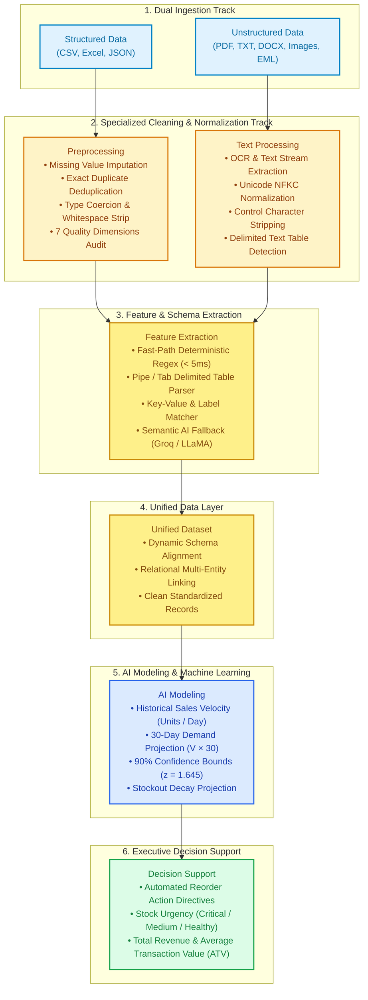
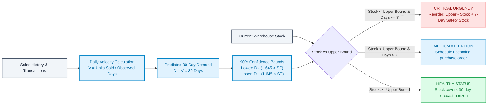
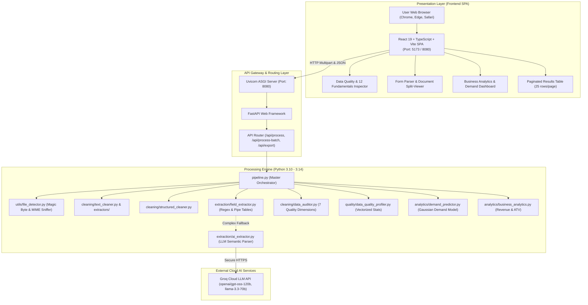
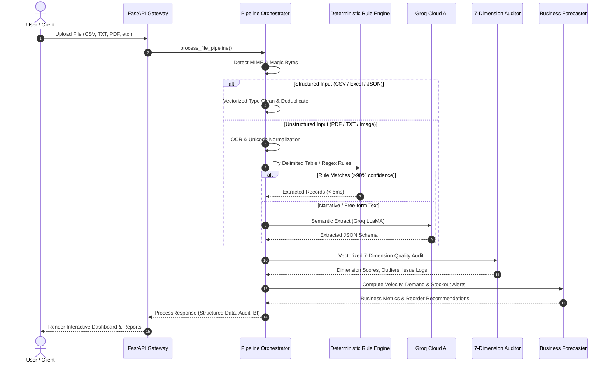

# DataFlow — Architecture & System Diagrams

This document contains the official architectural blueprints for **DataFlow**:
1. **Dual-Ingestion Enterprise Architecture** (From Input to Decision Support)
2. **Business Analytics & Predictive Demand Pipeline**
3. **Physical & Component Deployment Architecture**
4. **Cascading Extraction & Data Quality Verification Flow**

---

## 1. Dual-Ingestion Enterprise Architecture

DataFlow adopts a dual-path ingestion architecture where structured files (CSV, XLSX, JSON) and unstructured documents (PDF, TXT, DOCX, Images, EML) follow specialized preprocessing tracks before converging into a unified dataset for AI modeling and decision support.

---

## 2. Business Analytics & Predictive Demand Pipeline

How inventory stock levels, sales transactions, and historical velocity convert into automated procurement actions and executive metrics:

---

## 3. Physical & Component Deployment Architecture

---

## 4. Cascading Extraction & Data Quality Verification Flow

